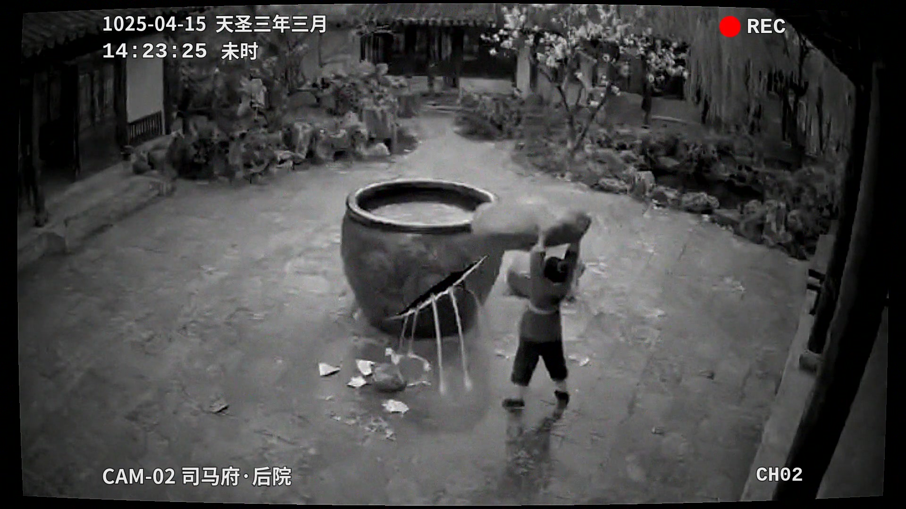
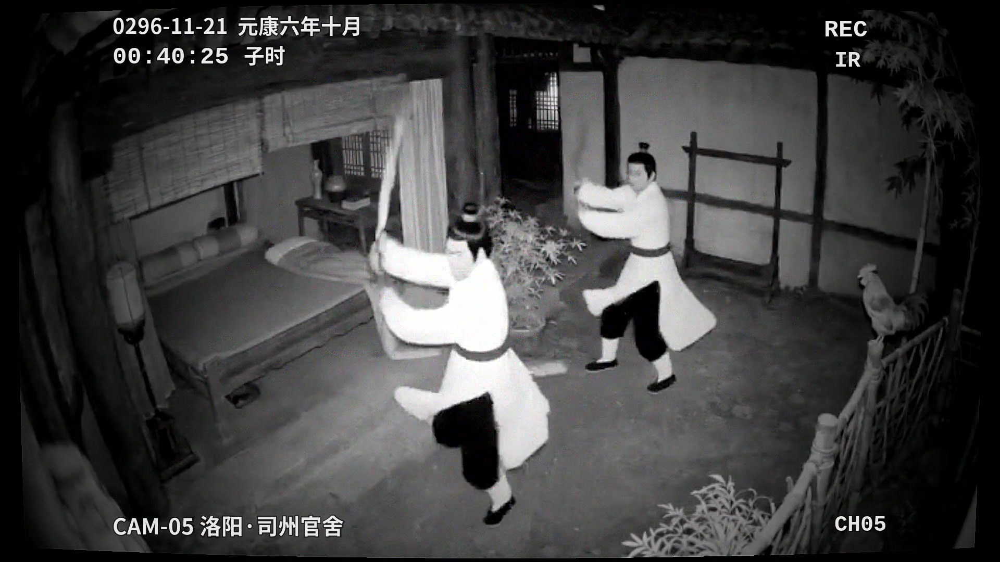
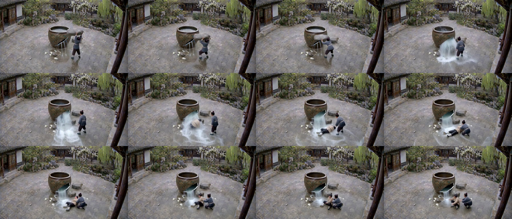
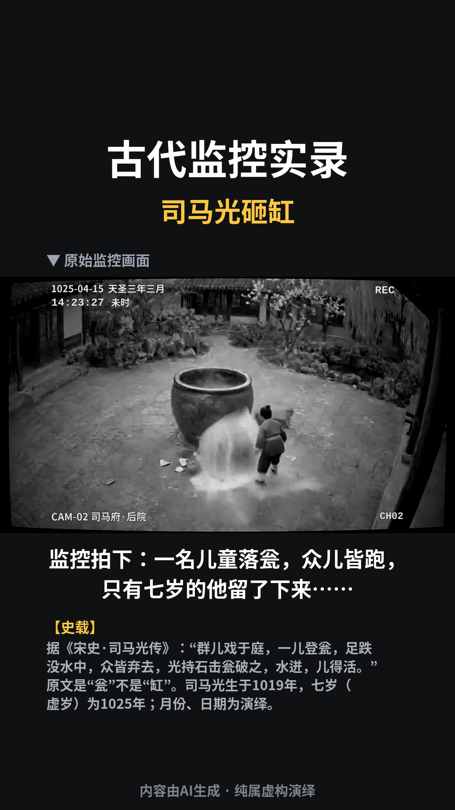

# H3 本地片场（h3-local-studio）

用一张 NVIDIA 显卡，在自己电脑上跑 MiniMax H3（FastH3 Omni 8 步）做 AI 视频：怎么装、提示词怎么写、按什么流程做、成片怎么自动质检，以及两种做成过的成片配方。

这里没有新模型，也没有一键成片。值钱的是踩坑记录：什么写法会翻车、为什么、换成什么写法。配套几个小工具：一个常驻渲染服务（模型只加载一次），一个提交客户端，一个提示词检查器，一个单条成片质检器，一个《古代监控实录》后期脚本。

[English README](README_EN.md)

## 样片

《古代监控实录》的《司马光砸瓮》《闻鸡起舞》两集用这套流程做成，发布在作者的微信视频号。两集的首帧、全部提示词、seed 和后期参数都在 [`recipes/cctv/episodes/`](recipes/cctv/episodes/)，可以照着复现。竖屏预览视频之后会放进各集的 `preview/` 目录。

下面几张是成片截图（内容由 AI 生成，纯属虚构演绎）：

| 司马光砸瓮 | 闻鸡起舞 |
|---|---|
|  |  |

验收用的 4×3 联系表（每秒 1.2 帧）和竖屏成片排版：





## 硬件门槛

下面的数字都是在 **RTX 5080（16 GB）** 上实测的。别的卡没有实测数，下表里凡是 5080 以外的结论都是按这些数算出来的。

| 项目 | 实测 / 算账 | 建议 |
|---|---|---|
| 显卡 | RTX 50 系用 NVFP4 版（默认）；RTX 30/40 系用同名 INT8 版（权重约 20 GB，NVFP4 在没有 FP4 张量核的卡上更慢） | RTX 50 最合适。30/40 系的速度和占用作者没测 |
| 显存 | H3 进程峰值 6.0–6.2 GB（12 s、1344×768 的 i2v，每 2 s 采样一次，连续 5 分钟） | 16 GB 很宽裕。12 GB 卡按算术在 768p 下约有 2 倍余量，但**作者没跑过 12 GB 的卡** |
| 内存 | 渲染进程常驻 22–28 GB。作者机器是 30 GB 内存 + 15 GB swap，swap 会被吃满，但能渲完 | 32 GB 起步，并配 ≥ 16 GB swap；64 GB 舒服 |
| 硬盘 | 模型文件合计约 35 GB | 留出约 50 GB（模型 + 成片） |
| 分辨率 | 1080p 实测：5 s 约 231–244 s，12 s 用 582 s（要 1920×1080，WanGP 实际输出 1888×1056），H3 进程显存约 9.8 GB | 16 GB 卡能出 1080p，但卡上要空出约 10 GB；默认仍用 768p（快约 2.6 倍）；12 GB 卡余量只有约 1 GB，没测过 |

## RTX 5080 实测速度

506 条真实任务的中位数。8 步，模型常驻不重载（第一次加载另算，见 [安装](docs/01-install.md)）。

| 任务 | 片长 | 中位耗时 |
|---|---|---|
| i2v（首帧 + 提示词）1344×768 | 5 s | 88 s |
| i2v 1344×768 | 10 s | 175 s |
| i2v 1344×768 | 12 s | 220 s |
| r2v（首帧 + 参考图 + 声音参考）768×1344 | 5 s | 90 s |
| r2v 768×1344 | 6 s | 111 s |
| r2v 768×1344 | 8 s | 144–153 s |
| r2v 768×1344 | 10 s | 190 s |

粗算：768p 下每秒成片大约要 18 s 渲染。

## 三步上手

1. **装 WanGP 和模型**：按 [docs/01-install.md](docs/01-install.md)。装完确认 WanGP 自己的 python 能跑起来。
2. **在仓库根目录起常驻渲染服务**（模型加载一次，之后每条任务直接渲）：

   ```bash
   ~/WanGP/.venv/bin/python tools/h3_server.py --wangp-dir ~/WanGP   # 换成你的 WanGP 目录和它的 python
   ```

3. **另开一个终端，同样在仓库根目录，提交一条镜头、等出片、质检**：

   ```bash
   python3 tools/h3.py submit --kind i2v --image recipes/cctv/episodes/smg/first_frame.png \
       --prompt-file recipes/cctv/episodes/smg/prompts/smg_c1.txt --secs 10 --seed 31 \
       --out outputs/smg/shots/smg_c1_s31.mp4 --wait
   python3 tools/take_gate.py outputs/smg/shots/smg_c1_s31.mp4
   bash tools/contact_sheet.sh outputs/smg/shots/smg_c1_s31.mp4
   ```

   服务和客户端默认都用当前目录下的 `queue/` 交换任务，所以两边要在同一个目录启动（或都传同一个 `--queue`）。一张卡同一时间只渲一条，多交的任务排队。

## 制作流程总览

先把图定死再动视频：改一张图 1 分钟，改一条视频要重渲，还会连累相邻镜头。


每一步的做法见 [docs/04-workflow.md](docs/04-workflow.md)。

## 目录

```
README.md / README_EN.md / LICENSE / NOTICE
tools/
  h3_server.py       常驻渲染服务：WanGP 只加载一次，按队列逐条渲（用 WanGP 自己的 python 跑）
  h3.py              客户端：submit / wait / status / list / cancel（只用标准库）
  prompt_lint.py     提示词检查：缺段、描述里的中文、太短太长、节拍过密（h3.py 提交前自动跑）
  take_gate.py       单条成片质检：模型自切、冻结、推拉、说话正对镜头、台词有没有说对
  qa/                take_gate 的测量与判定模块
  contact_sheet.sh   4×3 联系表（每秒 1.2 帧）
docs/
  01-install.md            安装：WanGP、FastH3、ffmpeg、可选依赖
  02-hardware-and-speed.md 显存/内存/硬盘算账、速度、时长与质量、没做什么和为什么
  03-prompt-guide.md       FastH3 结构化英文六段式提示词
  04-workflow.md           从故事到发布的十步流程
  05-recipe-cctv.md        《古代监控实录》配方入口
  06-recipe-wuxia-mv.md    唯美武侠 MV 配方
  07-recipe-drama.md       对白短剧要点
  08-lessons.md            踩坑清单：现象 → 原因 → 写法
recipes/cctv/              《古代监控实录》：配方、审校提示词、首帧配方、后期脚本、两集完整样例
```

## 许可与致谢

- 本仓库的代码和文档：MIT，见 [LICENSE](LICENSE)。第三方声明见 [NOTICE](NOTICE)。
- 仓库**不含** WanGP、模型权重和字体，全部由你自己下载安装，并遵守各自的许可。
- **WanGP**（[deepbeepmeep/WanGP](https://github.com/deepbeepmeep/WanGP)，WanGP Community License 2.0）：渲染引擎。本仓库只调用它公开的 Python API，不打包、不修改。
- **MiniMax H3**（MiniMaxAI，MiniMax H3 Community License）：MiniMax H3 is licensed under the MiniMax H3 Community License Agreement, Copyright © 2026 MiniMax. All Rights Reserved. 许可排除欧盟、英国、韩国、美国；使用须遵守其可接受使用政策，包括给 AI 生成内容加标识（附件 A 第 12 条）、不侵犯知识产权、不冒充真人。
- **FastH3 Omni 8 步**：FastVideo 的步数蒸馏版本，由 DeepBeepMeep 打包成 WanGP 可用的权重，发布在 Hugging Face。
- **角色脸型库方法**：来自远见明察的公开微信文章《GPT Image 2.5 做 Seedance 2.5 角色脸型库》（2026-11），本仓库用的是按这个方法改写的模板。
- 公开发布的每条 AI 视频都要带 AI 生成标识（H3 许可附件 A 第 12 条，以及国内的 AI 生成内容标识规定）。《古代监控实录》的竖屏版已经把「内容由AI生成 · 纯属虚构演绎」烧进画面。
